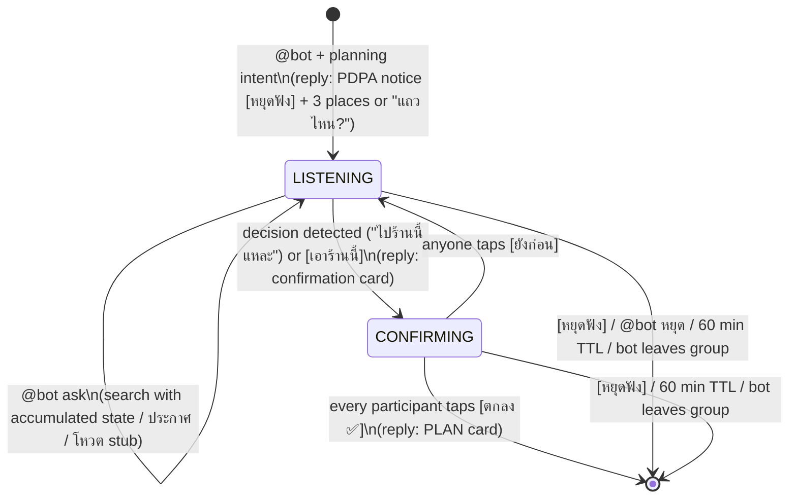

# Architecture: session engine

## Flow

```
LINE ──webhook──> WebhookFunction (Function URL)
                   - verify x-line-signature (401 if bad)
                   - drop stickers/"555"/"ok"/links-only/<3 chars (unless @mention)
                   - SQS FIFO, MessageGroupId = groupId  (ordered per group, dedup by webhookEventId)
                 ──> WorkerFunction (reserved concurrency 5)
                   - SessionEngine.handle(event)
                   - DynamoDB (single table), Gemini (small model), Places API (New)
                   - LINE reply API with the event's reply token (no push in the pilot)
```

Locally, `scripts/local_server.py` calls `SessionEngine.handle` directly (synchronously) with an
in-memory store. Same engine, no AWS.

## State machine (one per LINE group)



- **Participants** = users who sent a text message during the session (or tapped a card button).
- **Confirmation rule**: any group member may tap a confirmation button, but is registered as a
  participant first, for BOTH [ตกลง] and [ยังก่อน]. So a lurker who taps ตกลง becomes a required
  confirmer (the "n/m" count grows), and a lurker who taps ยังก่อน is counted and cancels the
  confirmation like anyone else. Nobody can affect the outcome without being counted.
- **Radius**: default 3 km (food) / 5 km (activity). "ไม่เกิน 5 กม./โล", "within 5 km" set it; "ไกลไป"
  halves it (min 1 km). Latest statement wins; stored as `Session.radius_km` (rules and LLM
  `MessageDelta.radius_km` / `radius_halve` share one merge path).
- **Offline spelling tolerance**: `adapters/lexicon.py` is a table (`ALIASES`) of slang, typos and simple
  English mapped to canonical Thai terms before the rules run (deterministic, add a row to extend).
- **Speaking rule**: the bot replies only to an @mention, a detected decision, or a button tap.
- **No session = no reading.** Non-mention messages are ignored entirely.

## Stored state (`GROUP#<id>` / `SESSION#active`, TTL = session end)

Extracted data only: area, group wants, per-user likes/dislikes/just-ate/budget, participants
(user IDs), last ≤3 suggestions (place_id, name, lat/lng, distance), candidate, acks, LLM call count.
Raw chat text is never stored or logged (error handlers log only the exception type, never tracebacks or messages). Other items: `EVENT#<id>/SEEN` (dedup, 1 day),
`QUOTA#GROUP#<g>#<day>` and `QUOTA#PLACES#<day>` counters (2 days).

## Cost guards

| Guard | Default | Where |
|---|---|---|
| LLM calls per session | 40, then free rule-based fallback | `SessionEngine._extract` |
| Searches per group per day | 10 | `SessionEngine._search_replies` |
| Places calls per day (global) | 300, counts every Places call incl. area geocode lookups | `SessionEngine._search_replies` (`spend`) |
| Kill switch | `BOT_ENABLED=false` | `SessionEngine.handle` |
| Chat reading needs Gemini paid tier | `GEMINI_PAID_TIER_CONFIRMED=true` | `Settings.chat_reading_enabled` |
| AWS Budgets alarm | USD 28 (~1,000 THB) | `template.yaml` |
| Common Bangkok areas resolved locally | no geocode call | `features/geo.AREA_CENTERS` |

## Failure modes

- Duplicate webhook: `webhookEventId` conditional write + FIFO dedup.
- Gemini timeout/error: rule-based extractor, reply still goes out.
- Places error: short "ค้นไม่ได้" reply; session kept.
- Expired reply token / worker crash: error logged; SQS retries up to 3 times then DLQ (+ alarm), but a retry
  is skipped if the event was already marked seen (TODO: un-mark on failure). No push fallback in the pilot.
- Concurrent messages in one group: FIFO per group serialises them.
