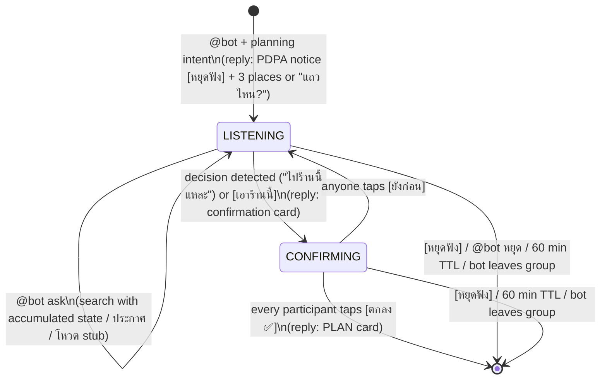

# Architecture: session engine

## Flow

```
LINE ──webhook──> WebhookFunction (Function URL)
                   - verify x-line-signature (401 if bad)
                   - drop stickers/"555"/"ok"/links-only/<3 chars (unless @mention)
                   - SQS FIFO, MessageGroupId = groupId  (ordered per group, dedup by webhookEventId)
                 ──> WorkerFunction (reserved concurrency 5)
                   - SessionEngine.handle(event)
                   - DynamoDB (single table), Gemini (small model), Places API (New)
                   - LINE reply API with the event's reply token (no push in the pilot)
```

Locally, `scripts/local_server.py` calls `SessionEngine.handle` directly (synchronously) with an
in-memory store. Same engine, no AWS.

## State machine (one per LINE group)



- **Participants** = users who sent at least one non-prefiltered text message during the session, or tapped a card button (see "Product rules").
- **Confirmation rule**: any group member may tap a confirmation button, but is registered as a
  participant first, for BOTH [ตกลง] and [ยังก่อน]. So a lurker who taps ตกลง becomes a required
  confirmer (the "n/m" count grows), and a lurker who taps ยังก่อน is counted and cancels the
  confirmation like anyone else. Nobody can affect the outcome without being counted.
- **Radius**: default 3 km (food) / 5 km (activity). "ไม่เกิน 5 กม./โล", "within 5 km" set it; "ไกลไป"
  halves it (min 1 km). Latest statement wins; stored as `Session.radius_km` (rules and LLM
  `MessageDelta.radius_km` / `radius_halve` share one merge path).
- **Offline spelling tolerance**: `adapters/lexicon.py` is a table (`ALIASES`) of slang, typos and simple
  English mapped to canonical Thai terms before the rules run (deterministic, add a row to extend).
- **Speaking rule**: the bot replies only to an @mention, a detected decision, or a button tap.
- **No session = no reading.** Non-mention messages are ignored entirely.

## Stored state (`GROUP#<id>` / `SESSION#active`, TTL = session end)

Extracted data only: area, group wants, per-user likes/dislikes/just-ate/budget, participants
(user IDs), last ≤3 suggestions (place_id, name, lat/lng, distance), candidate, acks, LLM call count.
Raw chat text is never stored or logged (error handlers log only the exception type, never tracebacks or messages). Other items: `EVENT#<id>/SEEN` (dedup, 1 day),
`QUOTA#GROUP#<g>#<day>` and `QUOTA#PLACES#<day>` counters (2 days).

## Cost guards

| Guard | Default | Where |
|---|---|---|
| LLM calls per session | 40, then free rule-based fallback | `SessionEngine._extract` |
| Searches per group per day | 10 | `SessionEngine._search_replies` |
| Places calls per day (global) | 300, counts every Places call incl. area geocode lookups | `SessionEngine._search_replies` (`spend`) |
| Kill switch | `BOT_ENABLED=false` | `SessionEngine.handle` |
| Gemini needs paid tier (fail closed) | `GEMINI_PAID_TIER=true` (legacy `GEMINI_PAID_TIER_CONFIRMED` also accepted) | `SessionEngine._gemini_allowed` |
| AWS Budgets alarm | USD 28 (~1,000 THB) | `template.yaml` |
| Common Bangkok areas resolved locally | no geocode call | `features/geo.AREA_CENTERS` |

## Failure modes

- Duplicate webhook: `webhookEventId` conditional write + FIFO dedup.
- Gemini timeout/error: rule-based extractor, reply still goes out.
- Places error: short "ค้นไม่ได้" reply; session kept.
- Expired reply token / worker crash: error logged; SQS retries up to 3 times then DLQ (+ alarm), but a retry
  is skipped if the event was already marked seen (TODO: un-mark on failure). No push fallback in the pilot.
- Concurrent messages in one group: FIFO per group serialises them.

## Product rules

Owner decisions from QA round 1 (2026-11-16). Open items and the defaults chosen are in `docs/BACKLOG.md`.

| Ref | Rule |
|---|---|
| Q-06 (PDPA, fail closed) | If env `GEMINI_PAID_TIER` is not exactly `true`, chat text is NEVER sent to Gemini, not even an @mention: the engine uses the offline rules and logs one warning line (once per process). Applies whenever the extractor is Gemini (`LLM_PROVIDER=gemini`). The legacy `GEMINI_PAID_TIER_CONFIRMED` setting also counts as paid. Non-mention chat is additionally not read at all while unpaid. Code: `SessionEngine._gemini_allowed`, `_extract`. |
| Q-01 | Participants = anyone who sent at least one non-prefiltered message in the session, or tapped a button (ack or pick). An @mention is always a message. |
| Q-02 | Messages that are only filtered noise (555, ok, links-only, emoji-only, stickers, images) do not make someone a participant. |
| Q-03 | Someone who becomes a participant while the group is confirming is added to the required confirmers and the confirmation card is re-posted once for that event (acks already given are kept). |
| Q-08 | A new search or plan change during the ack wait (an @mention search, a radius change, an area or search button) cancels confirming: state back to LISTENING, `candidate`/`acks` cleared, `confirm_round` bumped so the old card's buttons answer "ยกเลิกแล้ว". The reply starts with a cancellation line. Plain chatter never cancels. |
| Q-07 | Deferred: "place is open at the planned time" is not implemented (BACKLOG). |
| Decisions (BUG-11) | The bot speaks only when @mentioned, on a button, or on a real decision. Decision phrases are explicit ("ไปร้านนี้", "เอาร้านที่ N", "ตกลงไปร้าน..."). Questions and open answers ("ตกลงไปไหนกันแน่", "จบที่ไหนก็ได้", anything with ไหม/ป่ะ/?/ก็ได้) are never decisions, even if the LLM says so (`looks_undecided` guard in the engine). |
| Pick out of range (BUG-15) | "เอาร้านที่ 3" with 1 place: reply that option does not exist, no confirmation, state unchanged. |
| Budget (BUG-12 / Q-10) | "งบ N" is the group minimum. N<=100 -> Google price_level<=1, <=250 -> 2, <=500 -> 3, above -> 4. Places with no price_level are kept. |
| Radius (BUG-13/16) | Units: กม./กิโล/km and meters (ม./เมตร/m, min 0.1 km, shown as "400 ม."). Switching intent food<->activity resets the radius to the new kind's default unless the same message states one. A passive message never switches kind once suggestions exist; an @mention can. |
| Two areas (BUG-14/18/Q-05) | "ระหว่าง X กับ Y" (also กึ่งกลาง/ตรงกลาง) anchors on the MIDPOINT of X and Y (`Session.area2`; label "กึ่งกลาง X กับ Y"). "X หรือ Y" uses the area said FIRST. Never silently picks by table order. |
| Ranking (BUG-17) | Sort by rating desc, distance asc, then `place_id`: independent of the order Places returns. |
| Announcement (BUG-19) | Includes area, time ("เวลา: 20:00" or "ยังไม่ได้นัด") and place (candidate or "ยังไม่ได้เลือก"). |
| Session ids (BUG-20) | `SessionEngine(id_factory=...)` and `clock=` are injectable; the default id is random (uuid4) in production. The sandbox injects a seeded factory. |
